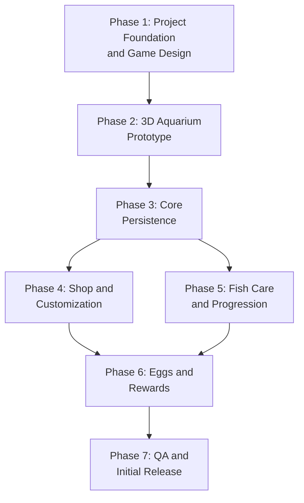

# MVP Roadmap — Fishora

> See also: [FISHORA_PROJECT.md](../FISHORA_PROJECT.md) · [GAME_DESIGN.md](GAME_DESIGN.md) · [TECHNICAL_ARCHITECTURE.md](TECHNICAL_ARCHITECTURE.md)

**Status:** Proposed sequence. Phase 1 is in progress (documentation task).

**Tentative estimate:** 4–8 weeks for a full-time solo developer using existing assets and a tightly scoped MVP. This is a rough estimate, not a commitment. Should be reassessed after the prototype.

---

## Roadmap Dependency Graph

> **Critical path:** The aquarium prototype (Phase 2) must demonstrate acceptable performance **before** backend development (Phase 3) begins. This prevents building server infrastructure for a frontend that cannot meet performance targets.

---

## Phase 1: Project Foundation and Game Design

**Status:** 🟡 In progress

**Goal:** Establish the canonical project document, detailed GDD, technical direction, and unresolved-decision list.

### Deliverables

- [x] `FISHORA_PROJECT.md` — canonical project overview.
- [x] `docs/GAME_DESIGN.md` — full game design document.
- [x] `docs/TECHNICAL_ARCHITECTURE.md` — technical direction and principles.
- [x] `docs/MVP_ROADMAP.md` — this roadmap.
- [x] `docs/decisions/README.md` — open decisions tracker.

### Exit Criteria

- All foundational documents exist and are internally consistent.
- Open decisions are explicitly recorded.
- The team (or solo developer) has reviewed and accepted the direction.

---

## Phase 2: 3D Aquarium Prototype

**Status:** ⬜ Not started
**Depends on:** Phase 1

**Goal:** Build a small, functional aquarium scene and validate rendering performance before investing in backend systems.

### Deliverables

- Next.js + React Three Fiber project scaffold.
- One complete aquarium scene with:
  - Tank geometry and water visual.
  - Fixed camera with zoom and adjustable viewing angle.
  - Aquarium lighting and environmental presentation.
  - 3–5 fish with natural-looking swimming animation.
  - Aquatic plants with subtle movement.
  - Rocks and decorative objects.
- Sample shop and inventory UI (non-functional or mock data).
- Object placement and movement interaction.
- Desktop and mobile interaction validation.
- FPS counter and basic performance instrumentation.

### Exit Criteria

- The aquarium renders and animates correctly.
- Desktop FPS meets or approaches the 60 FPS target.
- Mobile FPS is within the 30–60 FPS target range on a test device.
- Camera controls work on both desktop and mobile.
- Object placement interaction works on both input modes.
- Performance bottlenecks (if any) are identified and documented.
- A go/no-go decision is recorded before proceeding to Phase 3.

> **TBD:** Asset sources for fish and plant models. Free/purchased asset packs vs. custom-created models.

---

## Phase 3: Core Persistence

**Status:** ⬜ Not started
**Depends on:** Phase 2 (prototype validated)

**Goal:** Implement server-side systems for authentication, player data, inventory, aquarium layouts, and currency transactions.

### Deliverables

- Authentication system (method TBD).
- Database schema (PostgreSQL + Prisma).
- API routes for:
  - Player registration and login.
  - Wallet balance retrieval.
  - Inventory retrieval and management.
  - Aquarium layout saving and restoration.
  - Transaction history.
- Fish ownership tracking (owned vs. placed in aquarium).
- Basic error handling and input validation.

### Exit Criteria

- A player can register, log in, and retrieve their profile.
- Starting coins are granted correctly on account creation.
- Wallet balance updates are server-authoritative and consistent.
- Fish and item ownership persists across sessions.
- Aquarium layouts save and restore correctly.
- API routes return appropriate errors for invalid requests.

---

## Phase 4: Shop and Customization

**Status:** ⬜ Not started
**Depends on:** Phase 3

**Goal:** Let players spend coins on fish, eggs, and decorations, and manage their aquarium layout with full persistence.

### Deliverables

- Shop UI displaying available items with prices.
- Server-validated purchase flow (check balance → deduct coins → add item to inventory).
- Inventory UI showing owned items.
- Aquarium decoration placement with hybrid easy/precision controls.
- Layout persistence (save and restore item positions, rotations).
- Aquarium reconstruction on page load.
- Selling flow for eligible items.

### Exit Criteria

- Players can browse and purchase items.
- Purchases correctly deduct coins and grant items exactly once.
- Insufficient funds prevent purchases.
- Failed transactions do not leave currency and inventory inconsistent.
- Items can be placed, moved, rotated, and removed in the aquarium.
- Positions persist and restore correctly.
- Selling updates ownership and currency consistently.

---

## Phase 5: Fish Care and Progression

**Status:** ⬜ Not started
**Depends on:** Phase 3

**Goal:** Implement fish care interactions, quests, achievements, collection milestones, and the progression system.

### Deliverables

- Fish care indicators and feeding interaction.
- Care state persistence.
- Quest system with objectives and server-validated rewards.
- Achievement tracking.
- Collection milestone tracking and rewards.
- Progression/leveling system with content unlocks.

### Exit Criteria

- Fish care state persists correctly across sessions.
- Care consequences follow explicitly approved rules.
- Quests can be completed and rewards claimed exactly once.
- Collection milestones trigger correctly.
- Progression unlocks work as designed.

> **Prerequisite decisions:** Fish care indicators, decay rates, health consequences, and fish death policy must be resolved before implementation.

> **Note:** Phases 4 and 5 can be developed in parallel since both depend only on Phase 3.

---

## Phase 6: Eggs and Rewards

**Status:** ⬜ Not started
**Depends on:** Phases 4 and 5

**Goal:** Implement the egg system, daily login rewards, passive income, and complete the reward economy.

### Deliverables

- Egg acquisition (purchase, quest rewards, milestones, periodic free eggs).
- Egg incubation with server-authoritative timing.
- Hatching flow and fish delivery.
- Daily login reward system with duplicate prevention.
- Passive income accrual, storage limit, and collection.
- Free egg distribution at approved intervals.
- Complete reward economy validation.

### Exit Criteria

- Eggs hatch according to server-validated timing.
- One egg cannot produce multiple fish.
- Daily rewards cannot be claimed more than once per day.
- Passive income accrues correctly and respects storage limits.
- Free eggs are distributed at the correct intervals.
- Rewards cannot be exploited through repeated requests.
- The full economic loop (earn → spend → collect → progress) works end-to-end.

> **Prerequisite decisions:** Egg incubation durations, hatch outcome rules, passive income formula, and free egg frequency must be resolved before implementation.

---

## Phase 7: QA and Initial Release

**Status:** ⬜ Not started
**Depends on:** Phase 6

**Goal:** Test the complete MVP, fix issues, and deploy to a staging environment.

### Testing Areas

| Area | What to Verify |
|---|---|
| Transaction security | Currency cannot be duplicated or manipulated |
| Duplicate prevention | Rewards, daily claims, and egg hatches are idempotent |
| Data consistency | Inventory, wallet, care state, and layout data remain consistent |
| Authorization | All state-modifying operations require authentication |
| Timed systems | Daily rewards, egg incubation, and passive income use server time |
| Performance | FPS targets met on desktop and mobile |
| Cross-browser | Core functionality works in Chrome, Firefox, Safari, Edge |
| Responsive design | Desktop and mobile interactions are usable |
| Error handling | Graceful handling of network errors, invalid states |
| Deployment | Successful deployment to staging environment |

### Exit Criteria

- All critical bugs resolved.
- No known currency exploits.
- All timed systems use server-authoritative timestamps.
- Performance targets validated on test devices.
- Application deployed and accessible on a staging URL.

---

## Future Considerations (Post-MVP)

Potential additions after MVP validation (not committed):

- **Fishing gameplay** — rods, bait, fishing locations, server-authoritative catches.
- Additional rare fish species.
- New environments and aquarium themes.
- Aquarium upgrades (larger tanks, multiple tanks).
- Social features (view other players' aquariums).
- Seasonal events and limited-time content.
- Guided onboarding / tutorial.
- Monetization (if validated).

These will be prioritized based on player feedback and development capacity after the MVP is validated.
